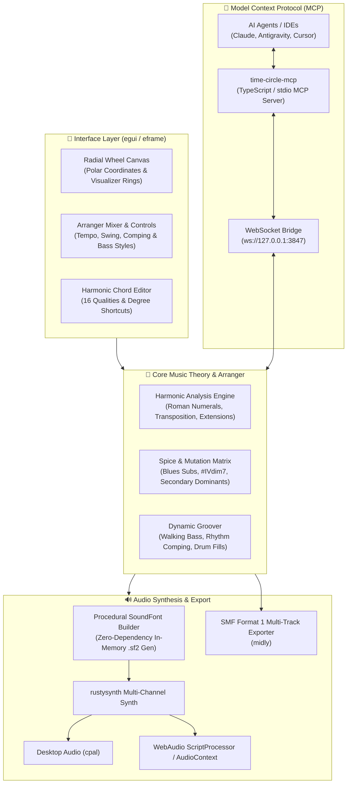

<div align="center">

# ⏱️ Time Circle
### Algorithmic Harmony & Groove Generator in Rust & WebAssembly

[](https://www.rust-lang.org/)
[](https://webassembly.org/)
[](https://github.com/leouofa/time-circle-mcp)
[](https://github.com/emilk/egui)
[](https://time-circle.gridbeat.wiki/)
[](LICENSE)

<br/>

**[🌐 Launch Live Web App](https://time-circle.gridbeat.wiki/)** &nbsp;&bull;&nbsp; **[🤖 MCP Server Repository](https://github.com/leouofa/time-circle-mcp)** &nbsp;&bull;&nbsp; **[🛠️ Architecture](#-system-architecture)** &nbsp;&bull;&nbsp; **[⚡ Quick Start](#-quick-start)**

<br/>

<p align="center">
  <b>Time Circle</b> is a high-performance music theory exploration engine and dynamic backing track synthesizer engineered in pure Rust. Built to run natively on Desktop (macOS, Linux, Windows) and seamlessly in the browser via WebAssembly (Wasm), it unifies harmonic analysis, procedural SoundFont audio synthesis, multi-track rhythm arranging, and AI agent interoperability via the <b>Model Context Protocol (MCP)</b>.
</p>

</div>

---

## 🌟 Highlights

- **🎯 Interactive Clockwork Wheel**: Intuitive radial visualization of 4, 8, 12, or 16 bars with Roman numeral harmonic color-coding, multi-chord bar subdivision (1–4 chords/bar), section tagging, and real-time rotating playhead.
- **⚡ Zero-Dependency Procedural Audio**: Generates an in-memory General MIDI SoundFont bank (`.sf2`) from scratch algorithmically—delivering instant, high-fidelity sound synthesis with zero external audio assets required.
- **🤖 Bidirectional AI / MCP Integration**: Fully controllable by LLM agents (Claude, Antigravity, Cursor) via a companion [MCP Server](https://github.com/leouofa/time-circle-mcp) running over a lightweight local WebSocket bridge.
- **🎸 Intelligent Rhythm & Arranger Engine**: Generates dynamic accompaniment across Blues, Pop & Rock, and Soul & R&B with authentic walking bass, funk backbeats, syncopated soul comping, and automated turnaround fills.
- **🎼 Studio-Grade MIDI Export**: Exports multi-track Standard MIDI Files (SMF Format 1) with dedicated conductor timeline markers, chords, bass, and drums for drag-and-drop DAW production.
- **🚀 Dual Compilation Targets**: Shared Rust codebase compiling to 60 FPS desktop applications (`cpal` + `wgpu`) and zero-install client-side WebAssembly (`WebAudio` + `canvas`).

---

## 📐 System Architecture



---

## 🤖 AI & Model Context Protocol (MCP) Integration

Time Circle features native agentic capabilities via the **[time-circle-mcp](https://github.com/leouofa/time-circle-mcp)** companion server. An embedded WebSocket bridge connects the Rust application directly to local AI assistants (Claude Desktop, Antigravity, Cursor, or any MCP client), allowing AI agents to analyze, compose, and audition musical ideas in real time.

### Available MCP Tools

| Tool | Description |
| :--- | :--- |
| `timecircle_get_state` | Inspects current key, tempo, swing, chord progression, and playback status. |
| `timecircle_set_progression` | Loads curated presets or custom progressions across any key. |
| `timecircle_set_bar_chords` | Updates chords in specific bars with multi-beat subdivision (1, 2, or 4 chords). |
| `timecircle_mutate` | Dynamically injects secondary dominants, tritone substitutions, and chord tensions scaled by spice level. |
| `timecircle_turnaround` | Generates authentic 2-bar blues turnarounds on the fly. |
| `timecircle_audition_chord` | Plays individual voicings through the real-time audio synthesizer. |
| `timecircle_export_midi` | Generates and exports multi-track MIDI arrangements directly to disk. |

### Example Agent Interaction

> **User:** *"Give me an 8-bar Neo-Soul chord progression in Db with a laid-back pocket groove and export it to MIDI."*
>
> **Agent:** Calls `timecircle_set_progression(key: "Db", preset: "Neo-Soul / Gospel Climb 8-Bar")` &rarr; `timecircle_set_drums_track(style: "Neo-Soul / R&B Laid-Back Pocket")` &rarr; `timecircle_export_midi(bars_count: 8)` &rarr; *"Progression arranged and saved to your project directory."*

---

## 🛠️ Core Architecture & Engineering Highlights

### 1. In-Memory Procedural SoundFont Synthesis
Instead of shipping bloated multi-megabyte sample banks, Time Circle implements a custom binary `.sf2` synthesizer generator (`soundfont_gen.rs`). It procedurally synthesizes GM-compliant acoustic piano, Rhodes EP, organ, upright bass, electric bass, and drum instruments in memory on startup, ensuring instantaneous load times and true zero-dependency deployment.

### 2. Universal Desktop & WebAssembly Audio Pipeline
The audio backend leverages a modular abstraction that targets native OS output via `cpal` for low-latency desktop playback while conditionally compiling to WebAssembly (`wasm-bindgen`, `web-sys`) to feed audio buffers straight into browser `AudioContext` and `ScriptProcessorNode` streams without third-party plugins.

### 3. Immediate-Mode Reactive UI (`egui`)
The user interface is built on `egui` immediate-mode architecture, rendering complex polar coordinates, animated harmonic visualizer rings, and real-time audio playback heads at a rock-solid 60 FPS across both desktop OpenGL/Metal and browser HTML5 Canvas.

### 4. Algorithmic Voice Leading & Dynamic Arranging
The accompaniment engine translates chord symbols into real-time voicings, generates walking bass lines with chromatic approach notes, and computes swing timing (from straight 50% to heavy 75% shuffles) using deterministic sub-beat tick math.

---

## 🎹 Musical Capabilities

### 17 Curated Presets across 3 Genres
- **Blues (7 Presets)**: Standard 12-Bar Blues, Quick-Change 12-Bar, Chicago Slow 12-Bar (`#IVdim7`), Jazz / Bird Blues 12-Bar, Minor Blues 12-Bar, 8-Bar Blues (*Key to the Highway*), and 16-Bar Extended Blues.
- **Pop & Rock (5 Presets)**: Pop Axis 4-Bar (`I – V – vi – IV`), 50s Doo-Wop / Ballad (`I – vi – IV – V`), Classic Rock Mixolydian (`I – bVII – IV – I`), Andalusian Cadence (`i – bVII – bVI – V7`), and Pop Verse + Chorus 16-Bar.
- **Soul & R&B (5 Presets)**: Minor Soul / Bill Withers (`i7 – V7 – i7 – IV9`), Royal Road Soul (`IVmaj7 – V7 – iii7 – vi7`), Neo-Soul / Gospel Climb 8-Bar (`IVmaj7 – III7 | vi7 – v7 I7`), Motown 8-Bar Groove, and 16-Bar Soul AABA.

### Deep Harmonic Vocabulary (16 Chord Qualities)
- **Triads & Pop/Rock extensions**: Major (`Maj`), Minor (`m`), `sus4`, `7sus4`, `add9`.
- **Jazz, Blues & Soul extensions**: `7`, `9`, `13`, `7alt`, `maj7`, `6`, `m7`, `m6`, `m9`, `m7b5`, `dim7`.

### Accompaniment & Comping Engine
- **Chords Track**: Acoustic Grand Piano, Rhodes EP, Hammond B3 Organ, Electric Guitar. Comping styles: Sustained Pads, Chicago Shuffle Chops, Slow 12/8 Triplet Arpeggio, Freddie Green Four-on-the-Floor, Charleston Syncopated, New Orleans Stabs, Pop 8th-Note Pulse, Neo-Soul Pocket.
- **Bass Track**: Upright Acoustic Bass & Fingered Electric Bass. Styles: Walking Bass (Quarter notes with chromatic approach), Texas/Chicago Shuffle Boogie, Slow 12/8 Blues, Two-Feel, Rock Driving 8ths, Motown Syncopated.
- **Drum Beat Track**: Chicago Shuffle, Slow 12/8 Blues, Texas SRV Double-Shuffle, New Orleans Second Line Funk, Jazz Blues Swing, Straight Rock, Pop/Rock 8th Backbeat, Motown Four-on-the-Floor, Neo-Soul Laid-Back Pocket, plus automated turnaround fills.

---

## ⚡ Quick Start

### 🌐 Web Version (No Installation Needed)
Experience Time Circle directly in your web browser:
👉 **[https://time-circle.gridbeat.wiki/](https://time-circle.gridbeat.wiki/)**

---

### 💻 Local Desktop Build

#### Prerequisites
- [Rust & Cargo](https://rustup.rs/) (1.75+ recommended)
- macOS / Linux / Windows audio toolchain (ALSA/libasound on Linux)

#### Build & Run
```bash
# Clone the repository
git clone https://github.com/leouofa/time-circle.git
cd time-circle

# Run unit & harmonic theory tests
cargo test

# Launch the desktop GUI
cargo run --release
```

---

### 🕸️ Building for WebAssembly Locally

```bash
# Install Trunk (WASM bundler)
cargo install trunk
rustup target add wasm32-unknown-unknown

# Serve locally with live reloading
trunk serve
```

---

### 🤖 Connecting the MCP Server

To enable AI agent control in Claude Desktop or Antigravity:

```bash
# Clone and build the MCP companion server
git clone https://github.com/leouofa/time-circle-mcp.git
cd time-circle-mcp
npm install && npm run build
```

Add to your MCP client configuration (`claude_desktop_config.json` or `antigravity.json`):
```json
{
  "mcpServers": {
    "timecircle": {
      "command": "node",
      "args": ["/path/to/time-circle-mcp/dist/index.js"]
    }
  }
}
```

---

## 📄 License

This project is licensed under the MIT License — see the [LICENSE](LICENSE) file for details.
